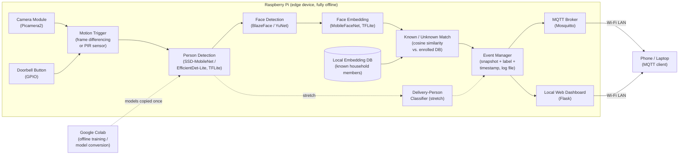

# DoorSense: An Intelligent but Offline Smart Doorbell

**EC-ENG 535/635: Networked Embedded Systems Design (Fall 2026), UMass Amherst**
**Instructor:** Prof. Fatima Anwar
**Team:** Ojas Singhvi · Munir Safwan
**Project category:** Edge AI

> **Project proposal.** This repository will hold all code, models, data-collection scripts, results, and the final report for the project.

---

## Table of Contents
1. [Motivation](#1-motivation)
2. [Design Goals](#2-design-goals)
3. [Deliverables](#3-deliverables)
4. [System Blocks](#4-system-blocks)
5. [Hardware / Software Requirements](#5-hardware--software-requirements)
6. [Team Members & Responsibilities](#6-team-members--responsibilities)
7. [Project Timeline](#7-project-timeline)
8. [References](#8-references)

---

## 1. Motivation

Smart doorbells (Ring, Nest, etc.) have become common household devices, but almost all of them work the same way: every frame or clip is uploaded to a company's cloud server, where the "smart" part (person detection, face recognition) actually happens. This design has three real problems:

- **Privacy:** Video of your front door, your family, and your visitors lives on someone else's server. Cloud doorbell footage has been shared with third parties and exposed in data breaches.
- **Dependence on the internet:** If the Wi-Fi or the company's servers go down, the doorbell loses its intelligence. Many features also require a monthly subscription.
- **Latency and bandwidth:** Streaming video to the cloud and waiting for a result adds delay and uses constant upload bandwidth.

Edge devices such as the Raspberry Pi are now powerful enough to run small, efficient neural networks (e.g., MobileNet-class models) locally. That makes it possible to build a doorbell that **detects people, recognizes known household members, and sends alerts entirely on the device and the local network, with no cloud at all.**

**Why we are interested:** We both use smart-home devices and wanted a project where we build something we would actually use. This project lets us work across the whole embedded pipeline, including hardware setup, Linux, on-device ML, and local networking, instead of only training a model on a laptop. It is also a concrete, demo-able way to learn the trade-offs between model accuracy, speed, and memory that come up in all edge AI systems.

---

## 2. Design Goals

| # | Goal | Target (to be refined after initial testing) |
|---|------|----------------------------------------------|
| G1 | **Fully offline:** all inference runs on the Raspberry Pi; no internet or cloud API is needed | 0 bytes sent to the internet during operation |
| G2 | **Person detection:** detect when a person appears at the door | Precision and recall ≥ 90% on our own test clips |
| G3 | **Known vs. unknown recognition:** classify a detected face as a known household member or an unknown visitor | ≥ 85% accuracy on our enrolled-member test set |
| G4 | **Low latency:** short time from person appearing to alert received | ≤ 2 s end-to-end on a Raspberry Pi 4/5 |
| G5 | **Lightweight:** models small enough for the edge | Total model size ≤ 20 MB; RAM use ≤ 1 GB |
| G6 | **Local-network alerts:** notify a phone or laptop on the same Wi-Fi network | Alert delivered over LAN (MQTT / local web dashboard) |
| G7 | **Easy enrollment:** add a new known person with a few photos | ≤ 10 images per person, no retraining required |
| G8 *(stretch)* | **Delivery-person detection:** flag likely delivery workers (uniform/package) | Proof-of-concept classifier trained on Colab |

---

## 3. Deliverables

1. **Working prototype:** a Raspberry Pi + camera doorbell that runs inference directly on the device (required by the project description).
2. **Edge ML pipeline (code):** motion trigger → person detection → face detection → face embedding → known/unknown match, using TensorFlow Lite / LiteRT models.
3. **Enrollment tool:** a script to add household members by capturing a few photos and storing their face embeddings locally.
4. **Local alert system:** event notifications (with snapshot, label, and timestamp) sent over the local network via an MQTT broker on the Pi and a simple local web dashboard; all events also logged to a file.
5. **Evaluation results:** accuracy (precision/recall), per-stage and end-to-end latency, FPS, model size, and memory use, plus a comparison of at least two model choices (e.g., different detector sizes or quantized vs. float models).
6. **Stretch goal:** delivery-person classifier (fine-tuned MobileNetV2 trained on Google Colab, deployed as TFLite).
7. **Final demo, visualizations, and report:** live demo, plots of latency and accuracy trade-offs, and a final write-up in this repository.

---

## 4. System Blocks

**Block descriptions**

| Block | Role |
|-------|------|
| **Camera + trigger** | Captures frames continuously at low resolution. A cheap motion check (or a PIR sensor or the doorbell button) wakes up the ML pipeline so the heavy models do not run on every frame, which saves CPU and power. |
| **Person detection** | A small object detector (COCO-pretrained, quantized TFLite) checks whether a person is in the frame. |
| **Face detection + embedding** | Finds the face in the person's bounding box and converts it to a fixed-length embedding vector with a lightweight face-recognition CNN. |
| **Known/unknown matching** | Compares the embedding with stored embeddings of household members (cosine similarity). Above the threshold → "Known: <name>", below → "Unknown visitor." This is the embedding approach suggested in the project description, and it needs no retraining to add new people. |
| **Event manager** | Saves a snapshot, label, confidence, and timestamp to a local log, and rate-limits duplicate alerts. |
| **Networking (local only)** | Publishes alerts to a Mosquitto MQTT broker running on the Pi (topic e.g. `doorbell/events`) and serves a Flask dashboard on the LAN. Devices on the home Wi-Fi receive alerts with **no internet connection**. |
| **Colab (development only)** | Used only for training and converting models (e.g., the stretch delivery-person classifier). Final models are copied to the Pi, which then runs fully offline. |

---

## 5. Hardware / Software Requirements

*(hw/sw = hardware/software)*

### Hardware
We plan to borrow these parts from the department/lab.

| Component | Purpose |
|-----------|---------|
| Raspberry Pi 4 Model B (4 GB+) **or** Raspberry Pi 5 | Edge compute device running all inference |
| Raspberry Pi Camera Module 3 (or v2, or a USB webcam) | Captures images at the door |
| microSD card (32 GB+, Class 10) | OS + models + event logs |
| Official Raspberry Pi USB-C power supply | Stable power under load |
| Push button + jumper wires | Physical doorbell button (GPIO) |
| *(Optional)* PIR motion sensor (HC-SR501) | Low-power motion trigger |
| *(Optional)* Buzzer / LED | Local chime / status indicator |
| *(Optional)* Case + heatsink/fan | Thermal stability during continuous inference |
| Laptop + phone | Development, SSH access, receiving alerts |

### Software
| Software | Purpose |
|----------|---------|
| Raspberry Pi OS (64-bit, Bookworm) | Linux OS on the Pi |
| Python 3.11 | Main programming language |
| Picamera2 / libcamera | Camera capture |
| OpenCV | Image preprocessing, face detection (YuNet), drawing boxes |
| TensorFlow Lite runtime / LiteRT (`ai-edge-litert`) | On-device model inference |
| NumPy | Embedding math (cosine similarity) |
| Mosquitto + `paho-mqtt` | Local MQTT broker and client for alerts |
| Flask | Local web dashboard for events/snapshots |
| `gpiozero` | Doorbell button / PIR / buzzer |
| Google Colab + TensorFlow/Keras | Model training, fine-tuning, TFLite conversion and quantization |
| Git + GitHub | Version control and documentation |

**Pretrained models (candidates):** SSD-MobileNet v2 or EfficientDet-Lite0 (person detection, COCO), BlazeFace or OpenCV YuNet (face detection), MobileFaceNet (face embeddings), MobileNetV2 (stretch: delivery-person classifier via transfer learning).

---

## 6. Team Members & Responsibilities

Both members contribute to every part of the project. The **lead** for each area owns its planning and makes sure it gets done.

| Lead Role | Lead | Support | What it covers |
|-----------|------|---------|----------------|
| **Setup** | **Munir Safwan** | Ojas | Getting hardware from the department, flashing Raspberry Pi OS, SSH/headless setup, camera and GPIO wiring, Python environment, installing TFLite/OpenCV on the Pi |
| **Software** | **Munir Safwan** | Ojas | Overall application structure on the Pi, camera capture loop, event manager, logging, enrollment script, integrating all pipeline stages |
| **Networking** | **Munir Safwan** | Ojas | Mosquitto MQTT broker, publish/subscribe alert topics, Flask LAN dashboard, verifying the system works with no internet connection |
| **Research** | **Ojas Singhvi** | Munir | Literature review of lightweight CNNs and face recognition, choosing candidate models, defining the evaluation methodology and metrics |
| **Algorithm Design** | **Ojas Singhvi** | Munir | Detection → face → embedding → matching pipeline, similarity threshold tuning, model quantization and comparison, stretch delivery-person classifier on Colab |
| **Writing** | **Ojas Singhvi** | Munir | Proposal, README/documentation, check-in updates, results visualizations, final report |

**Why this split:** Munir has stronger Linux experience, so he leads the Pi setup, on-device software, and networking. Ojas leads the ML research, algorithm design, and writing. Both members will test the full system and present the final demo together.

---

## 7. Project Timeline

Ten weeks, from the proposal (Oct 3) to the final demo (around the week of Dec 7). The final demo and report dates will be updated once they are announced.

| Week | Dates (2026) | Tasks | Lead | Milestone |
|------|--------------|-------|------|-----------|
| 0 | Sep 28 – Oct 4 | Choose project, email instructor, create GitHub repo, write proposal | Both | ✅ **Proposal submitted (Oct 3)** |
| 1 | Oct 5 – Oct 11 | Borrow hardware; flash Pi OS; SSH + camera working; literature review of models | Munir / Ojas | Pi captures images |
| 2 | Oct 12 – Oct 18 | Run a pretrained person detector (TFLite) on the Pi; measure baseline FPS/latency | Ojas / Munir | Person detection on device |
| 3 | Oct 19 – Oct 25 | Add face detection + face embeddings; write enrollment script; collect our own test photos | Ojas | Faces → embeddings |
| 4 | Oct 26 – Nov 1 | Known/unknown matching + threshold tuning; motion/button trigger | Ojas / Munir | **Core pipeline works end-to-end** |
| 5 | Nov 2 – Nov 8 | Mosquitto MQTT alerts + event logging with snapshots | Munir | Alerts reach phone over LAN |
| 6 | Nov 9 – Nov 15 | Flask local dashboard; full offline test (internet disconnected) | Munir | **Mid-project check-in demo** |
| 7 | Nov 16 – Nov 22 | Evaluation: accuracy, latency per stage, memory; compare quantized vs. float / two detector sizes | Ojas | Results tables and plots |
| 8 | Nov 23 – Nov 29 | *Thanksgiving week (light).* Stretch: delivery-person classifier on Colab → TFLite | Ojas | Stretch goal (if on track) |
| 9 | Nov 30 – Dec 6 | Bug fixes, robustness tests (lighting, distance, multiple people), demo rehearsal | Both | Feature freeze |
| 10 | Dec 7 – Dec 11 | Final demo, visualizations, final report, clean up repo | Both | **Final demo + report** |

**Risks and backup plans**
- *Hardware delay:* start development on a laptop webcam with the same Python code, then move to the Pi.
- *Inference too slow on the Pi:* use smaller or int8-quantized models, lower the input resolution, and run detection only when motion is detected.
- *Face recognition accuracy too low:* add more enrollment images per person, tune the threshold, and average embeddings over several frames.

---

## 8. References

1. A. G. Howard et al., "MobileNets: Efficient Convolutional Neural Networks for Mobile Vision Applications," arXiv:1704.04861, 2017. https://arxiv.org/abs/1704.04861 *(reference provided in the project description)*
2. M. Sandler, A. Howard, M. Zhu, A. Zhmoginov, L.-C. Chen, "MobileNetV2: Inverted Residuals and Linear Bottlenecks," *CVPR*, 2018. https://arxiv.org/abs/1801.04381
3. W. Liu et al., "SSD: Single Shot MultiBox Detector," *ECCV*, 2016. https://arxiv.org/abs/1512.02325
4. F. Schroff, D. Kalenichenko, J. Philbin, "FaceNet: A Unified Embedding for Face Recognition and Clustering," *CVPR*, 2015. https://arxiv.org/abs/1503.03832
5. S. Chen, Y. Liu, X. Gao, Z. Han, "MobileFaceNets: Efficient CNNs for Accurate Real-Time Face Verification on Mobile Devices," arXiv:1804.07573, 2018. https://arxiv.org/abs/1804.07573
6. V. Bazarevsky et al., "BlazeFace: Sub-millisecond Neural Face Detection on Mobile GPUs," arXiv:1907.05047, 2019. https://arxiv.org/abs/1907.05047
7. Google AI Edge, "LiteRT (formerly TensorFlow Lite) documentation." https://ai.google.dev/edge/litert
8. Raspberry Pi Ltd., "The Picamera2 Library" manual. https://datasheets.raspberrypi.com/camera/picamera2-manual.pdf
9. OASIS, "MQTT Version 5.0" specification, 2019. https://docs.oasis-open.org/mqtt/mqtt/v5.0/mqtt-v5.0.html
10. Eclipse Mosquitto, an open-source MQTT broker. https://mosquitto.org/
